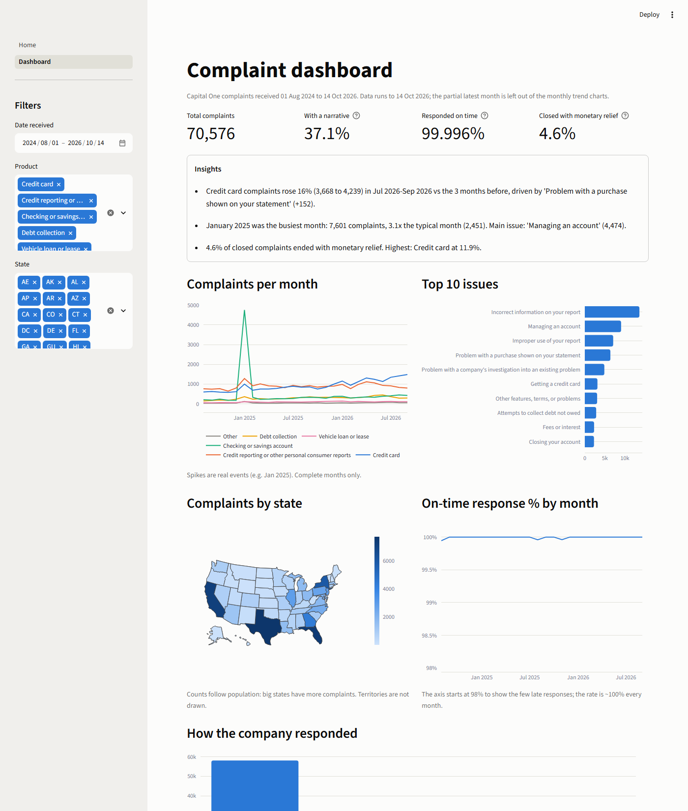

# ComplaintIQ

A complaint intelligence platform built on **public CFPB complaint data about Capital One**: ingestion, cleaning, analytics, AI triage, regulation lookup, risk alerts and a human-in-the-loop analyst app.

> **Disclaimer:** portfolio project using public CFPB data. Not affiliated with Capital One or the CFPB.

## Setup
```
py -3.11 -m venv .venv
.venv\Scripts\pip install -r requirements.txt
copy .env.example .env   # then add your API key
```

_Full README (results, architecture, screenshots) is completed in Phase 9._

## Ingestion (Phase 2)
```
python -m src.ingest.cfpb archive   # narratives archive (FOIA Reading Room zips in data/archive/)
python -m src.ingest.cfpb bulk      # bulk CSV: refreshes status, adds newest rows (add --download to re-fetch)
python -m src.ingest.cfpb api       # incremental from the live API (last loaded date - 7 days)
python -m src.ingest.cfpb check     # counts per month/product, flags empty months
```
Log of the first run (all loads are upserts keyed on `complaint_id`; re-runs add nothing):
```
archive: fetched 66,963, 66,963 new, 0 updated | table rows 0 -> 66,963
archive (again): 0 new, 0 updated                 | table rows 66,963
bulk:    fetched 70,521, 3,613 new, 610 updated   | table rows 66,963 -> 70,576
bulk (again): 0 new, 0 updated                    | table rows 70,576
api:     fetched 53, 0 new, 0 updated             | table rows 70,576
check:   70,576 rows | 26,157 with narrative (37.1%) | months 2024-08..2026-10, none missing or low
```
Why three sources: the CFPB stopped publishing narratives in Aug 2026, so text comes from the archive while structure/status comes from the bulk file and API. Details in `docs/data-profile.md`.

## Dashboard (Phase 4)
```
python -m streamlit run src/app/Home.py     # then open the Dashboard page
```


Filters (date, product, state) update the KPIs, insights and every chart. All numbers come from one SQL view, `v_dashboard_facts` (`src/transform/models.sql`), so they cannot disagree. Three findings it shows about Capital One:
1. **Jan 2025 spike:** 7,601 complaints, 3.1x the typical month (2,451); 4,474 were "Managing an account" on checking/savings, mostly one copied direct-deposit complaint.
2. **Credit cards are rising:** +16% (3,668 to 4,239) in Jul-Sep 2026 vs the 3 months before, driven by "Problem with a purchase shown on your statement" (+152).
3. **Monetary relief is rare and uneven:** 4.6% of closed complaints overall, but 11.9% for credit cards.

## AI triage (Phase 5)
Needs a free Gemini key: put `GEMINI_API_KEY=...` in `.env` (never commit it).
```
python -m src.ai.llm models              # models your key can use (optionally set GEMINI_MODEL in .env)
python -m src.ai.triage sample 1500      # choose the complaints once (reproducible)
python -m src.ai.triage run v1 --limit 50  # triage up to 50 not-yet-done complaints (re-run to continue)
python -m src.ai.triage summary v1       # valid %, tokens, estimated paid cost
```
Each complaint: PII masking (Presidio) -> prompt `prompts/triage_v1.txt` -> Gemini JSON -> Pydantic validation -> `complaint_triage` table.

First results (200 complaints, prompt v1, `gemini-3.5-flash-lite`, free tier): 100% valid output, ~1,300 input / 110 output tokens per complaint, about $0.0007 per complaint at paid-tier list prices. Accuracy against human labels is measured in Phase 6 (`docs/evals.md`).

## Evaluation (Phase 6)
The AI is scored against 100 complaints labeled by a human (the project owner), never by an AI.
```
python -m evals.gold                       # choose the 100 gold complaints (done once; ids in evals/gold_set.csv)
python -m streamlit run evals/label_app.py --server.port 8502   # human labels them (saved to evals/gold_labels.csv)
python -m src.ai.triage run v1 --gold      # AI answers for the gold complaints
python -m evals.run_eval v1 --errors 15    # accuracy, confusion matrix, worst mistakes
python -m evals.run_eval v1 v2             # compare two prompt versions
```
Results and the v1 to v2 table are written up in `docs/evals.md`.

Prefer Excel to the web page? `python -m evals.excel_labels make` writes `data/gold_labeling.xlsx` (dropdowns + rubric sheet); after filling it, `python -m evals.excel_labels import` checks every row and saves your labels to `evals/gold_labels.csv`.

**Results (100 hand-labeled complaints, prompt v1 to v2):** root cause accuracy 80% to 84%, severity within +-1 95% to 97%, critical complaints rated 3 or lower 3 of 14 to 0 of 14, cost about $0.0009 per complaint at paid-tier prices. Full analysis, regressions and caveats in `docs/evals.md`.

## Regulation lookup and risk alerts (Phase 7)
```
python -m src.ingest.regulations download        # official text from eCFR (Reg E, F, V, Z), data/regulations/
python -m src.ai.regulations_rag index           # embed the sections into ChromaDB
python -m src.ai.clusters build                  # embed all narratives, 30 clusters, LLM-named
python -m src.ai.clusters alerts                 # growth rule -> risk_alerts table (with suggested regulations)
python -m evals.regulation_check make            # 20-complaint workbook for a human to judge the suggestions
```
Every suggestion is checked in code against the retrieved sections (no invented citations) and labeled "Suggestion for compliance review - not legal advice."
